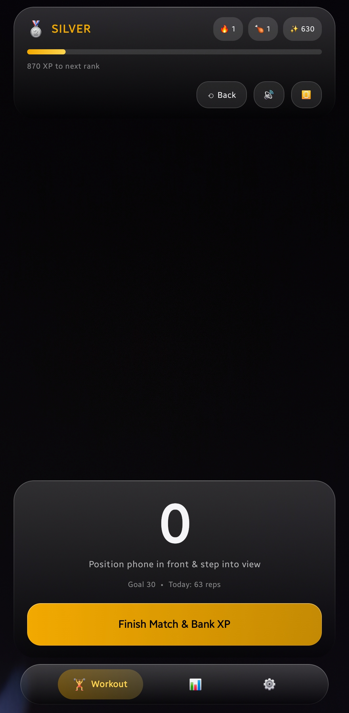
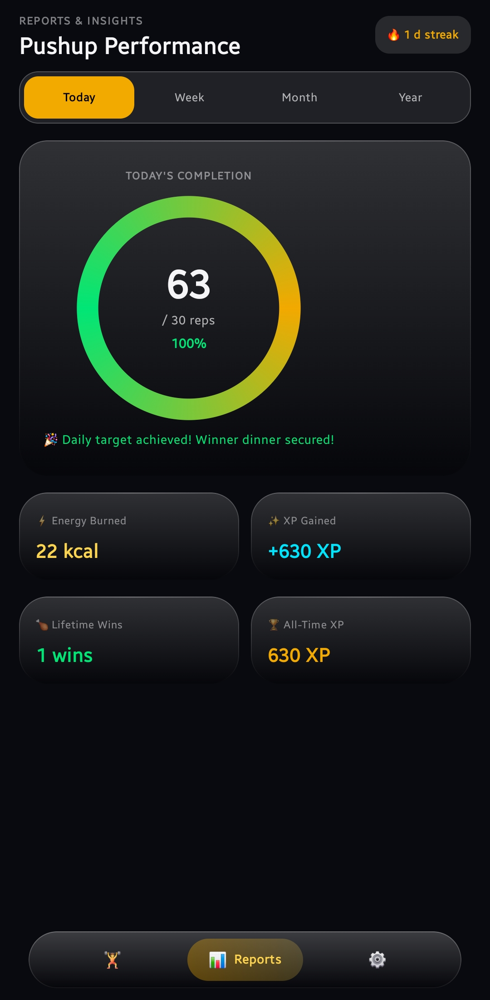
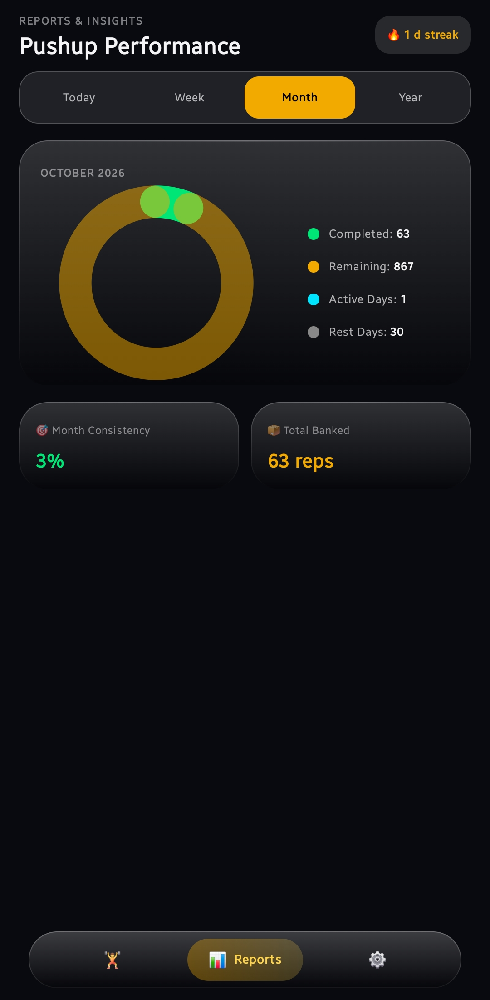
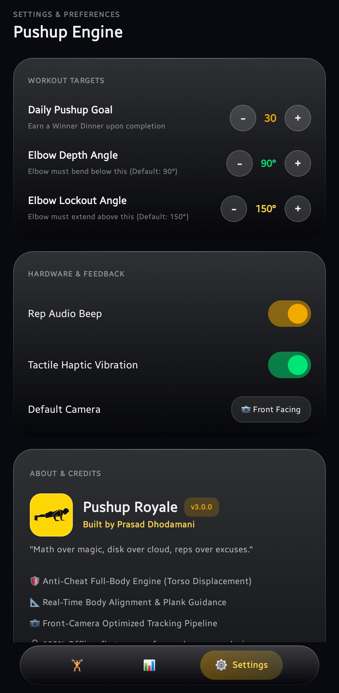

# 🍗 Pushup Royale

<p align="center">
  
</p>

<p align="center">
  <b>On-Device AI Full-Body Pushup Tracker & Battle Royale Progression Engine</b><br>
  <i>"Math over magic, disk over cloud, reps over excuses."</i>
</p>

<p align="center">
  
  <a href="LICENSE"></a>
  
  
  
  
  
  
</p>

---

## 🌟 Overview

**Pushup Royale** is an offline-first fitness application that turns daily pushups into a competitive Battle Royale ranking system. Using on-device computer vision powered by **Google ML Kit Pose Detection** and **CameraX**, it tracks your exercise form in real time through the phone's front camera—with zero cloud dependencies and 100% privacy.

---

## 📸 Screenshots

| Live Workout & Positioning | Today's Goal Ring |
| :---: | :---: |
|  |  |
| **Live Workout HUD**<br/>Front-camera positioning feedback, rank progress bar, rep counter, and Liquid Glass navigation. | **Today's Completion**<br/>Daily goal completion donut, calories burned estimate, XP gained, and daily win progress. |

| Monthly Analytics Donut | Pushup Engine Settings |
| :---: | :---: |
|  |  |
| **Monthly Analytics**<br/>Completed vs Remaining target donut chart, active/rest days balance, and consistency metrics. | **Settings & Engine**<br/>Configurable workout targets, depth/lockout angles, feedback toggles, and Prasad Dhodamani credits. |

---

## 🚀 Key Features

### 🛡️ Full-Body Computer Vision AI & Anti-Cheat (v3.0.0)
- **Full Kinematic Analysis**: Evaluates full-body posture across 14 key landmarks (shoulders, elbows, wrists, hips, knees, ankles, head/nose).
- **Anti-Cheat Torso Displacement**: Moving hands or bending elbows while sitting will **never count as a rep**. Requires verified vertical torso displacement (shoulders descending relative to grounded wrists).
- **Plank Line & Body Alignment Biofeedback**: Real-time checking of Shoulder $\to$ Hip $\to$ Ankle/Knee alignment angle ($\ge 135^\circ$), alerting if hips sag or pike.
- **Front-Camera Positioning Guidance**: Intelligent live instructions when placing phone on the floor in front of your mat (*"Move back — ensure hips & legs are in frame"*, *"Straighten body — don't sag hips!"*, *"Ready! Lower your chest"*).
- **High-Performance Pipeline**: 480×640 camera target resolution with atomic single in-flight inference lock for silky-smooth 30+ FPS tracking.

### 💎 Apple-Inspired Liquid Glass UI
- Translucent frosted glass panels (`GlassPanel`), specular highlights, and fluid squircle cards.
- Live full-body skeletal canvas overlay with glowing nodes and color-coded feedback (Gold for ready, Mint for bottom depth, Coral for form warnings).
- Floating liquid glass navigation bar and glowing ambient effects.

### 📊 Multi-Period Analytics & Reports (Daylatch Companion Style)
- **Today**: Goal completion donut ring, XP gained, calories burned estimate, daily win progress.
- **Week**: 7-Day interactive bar chart with capsule bars and highlighted current day.
- **Month**: Completed vs Remaining target donut chart and Active vs Rest day balance.
- **Year**: 12-Month yearly volume bar chart and lifetime statistics.

### 🍗 Battle Royale Gamification Ladder
- 8 Ranks: **Bronze** (0 XP) $\to$ **Silver** (500) $\to$ **Gold** (1,500) $\to$ **Platinum** (3,500) $\to$ **Diamond** (7,000) $\to$ **Crown** (12,000) $\to$ **Ace** (20,000) $\to$ **Conqueror** (35,000 XP).
- **"Winner Winner Pushup Dinner!"** celebration banner when daily goal is reached.
- Daily workout streaks and session history.

### 🔒 100% Privacy & Local-First
- Zero internet permission (`INTERNET` permission is absent from manifest).
- Zero camera frames or user data ever leave your device.
- All stats, history, and preferences are stored exclusively on local disk.

---

## 🛠️ Tech Stack

- **Language:** Kotlin 1.9.24 (JVM Target 17)
- **UI Framework:** Jetpack Compose (BOM `2024.06.00`, Material 3, Compiler Extension `1.5.14`)
- **Camera:** Android Jetpack CameraX 1.3.4 (`camera-camera2`, `camera-lifecycle`, `camera-view`)
- **AI / Computer Vision:** Google ML Kit Pose Detection (`com.google.mlkit:pose-detection:18.0.0-beta4`, STREAM_MODE bundled offline)
- **Platform:** Android SDK 34 (Min SDK 24, Target SDK 34)
- **Build System:** Gradle 8.5.2 / 9.8.1 with native ARM64 AAPT2 integration

---

## 📂 Project Structure

```text
PushupRoyale/
├── app/
│   ├── src/main/
│   │   ├── java/com/example/pushuproyale/
│   │   │   ├── MainActivity.kt     # Liquid Glass UI, Navigation, Canvas Overlay, Analytics
│   │   │   ├── PushupAnalyzer.kt   # Full-body pose kinematics, Anti-cheat & Guidance engine
│   │   │   └── Ranks.kt            # Battle Royale XP ladder, Analytics engine & Local storage
│   │   ├── res/                    # Adaptive launcher icons, drawables, theme tokens
│   │   └── AndroidManifest.xml     # Offline camera permissions & lifecycle hooks
│   ├── src/test/
│   │   └── java/com/example/pushuproyale/
│   │       ├── PushupGeometryTest.kt  # JUnit 4 geometry & strict plank verification tests
│   │       └── RanksLogicTest.kt      # JUnit 4 battle royale XP ladder & progress tests
│   └── build.gradle.kts            # App dependencies & compiler configuration
├── release/
│   ├── CHANGELOG.md                # SemVer versioning guide & release history
│   ├── v1.0.0/                     # Initial MVP release metadata
│   ├── v2.0.0/                     # Liquid Glass UI & Reports release
│   ├── v3.0.0/                     # Full-Body AI Tracking & Anti-Cheat release
│   └── v3.0.1/                     # Engine Hardening, Lifecycle Safety & Test Suite
├── screenshots/                    # App UI screenshots
│   ├── workout_tracking.jpg        # Live workout screen
│   ├── reports_today.jpg           # Today completion donut chart
│   ├── reports_month.jpg           # Monthly volume donut chart
│   └── settings_engine.jpg         # Settings & Prasad Dhodamani credits
├── LICENSE                         # Official MIT License (Prasad Dhodamani)
├── README.md                       # Project documentation & visual gallery
├── logo.png                        # Official app brand asset
├── build.gradle.kts                # Root build script
├── gradle.properties               # Native AAPT2 override configuration
└── settings.gradle.kts             # Gradle project settings
```

---

## 🧪 Automated Unit Testing

Pushup Royale includes a local JUnit 4 unit testing suite covering mathematical kinematics, plank alignment integrity, and rank progression calculations without needing an Android emulator:

```bash
# Execute local unit tests (100% offline)
GRADLE_OPTS="-Xmx1536m -Dorg.gradle.daemon=false" gradle --no-daemon test
```

- **`PushupGeometryTest`**: Validates 3-point joint angle calculations across 90°, 180°, and acute angles, strict normalization between 0° and 180°, and enforces that null or occluded lower-body landmarks never pass the plank check.
- **`RanksLogicTest`**: Validates the 8-tier Battle Royale ladder (Bronze $\to$ Conqueror), XP calculations, tier-boundary progress fractions, and default preferences.

---

## 🏷️ Versioning Scheme

Pushup Royale follows [Semantic Versioning (SemVer 2.0.0)](https://semver.org/):
- **MAJOR (`X.0.0`)**: Breaking architectural changes, AI model upgrades, core engine rewrites (v1.0.0 MVP, v2.0.0 Glass UI & Analytics, v3.0.0 Full-Body Anti-Cheat AI).
- **MINOR (`x.Y.0`)**: Backward-compatible feature additions (workout modes, sound packs).
- **PATCH (`x.y.Z`)**: Backward-compatible bug fixes, performance tuning, threshold adjustments.

---

## 👨‍💻 Developer & Credits

**Pushup Royale** is designed & developed by **Prasad Dhodamani** as part of the companion fitness and habit optimization suite alongside **Daylatch**.

- **Author:** Prasad Dhodamani
- **GitHub:** [@prasaddhodamani910-cell](https://github.com/prasaddhodamani910-cell)
- **Philosophy:** *"Math over magic, disk over cloud, reps over excuses."*

---

## 📄 License

This project is licensed under the MIT License - see the [LICENSE](LICENSE) file for details.

Copyright (c) 2026 Prasad Dhodamani.
